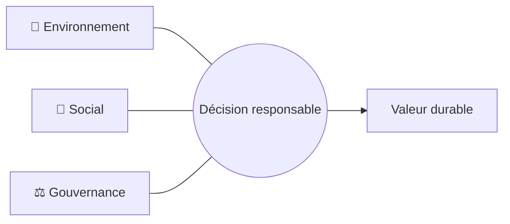
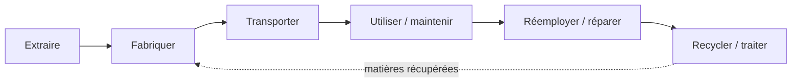
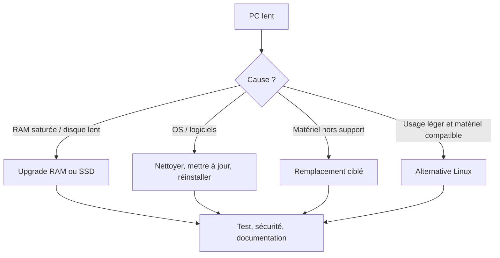
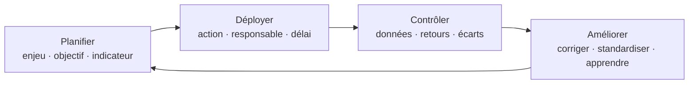
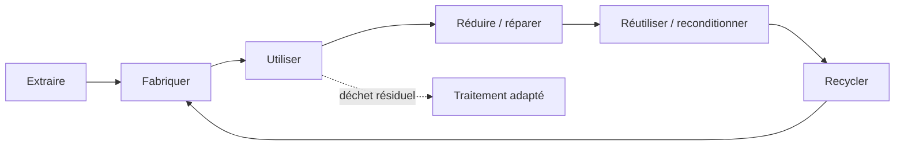
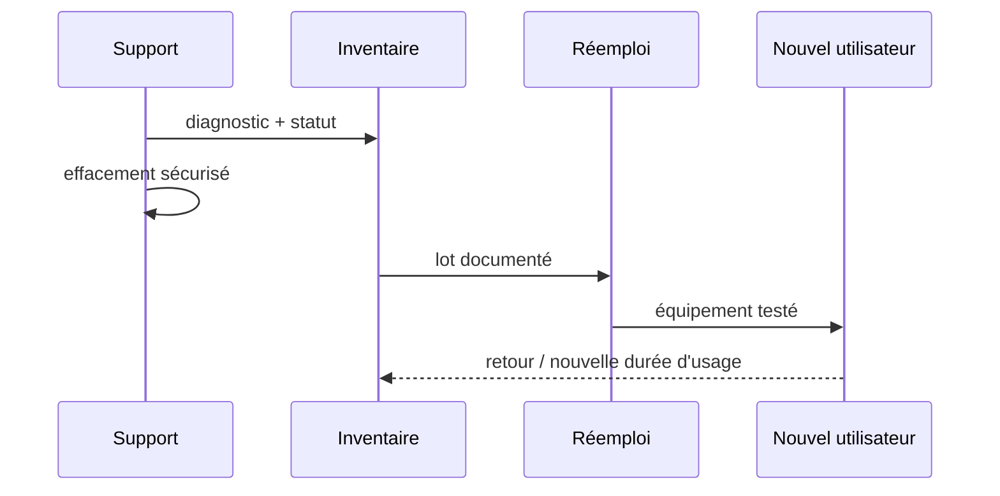

# RSE appliquée au numérique

### Technicien Informatique de Proximité · TIP

Faire durer, faire mieux, inclure.

<!--
Timing : 5 min. Accueillir, donner le fil rouge : chaque décision de support est aussi une décision de ressources, de coûts et d'inclusion.
-->

---

# Objectifs du module

À l'issue de la séance, vous saurez :

- expliquer les **principes de la RSE** ;
- repérer les **impacts environnementaux du numérique** ;
- appliquer des **bonnes pratiques** dans le support ;
- contribuer à une **démarche responsable** ;
- favoriser l’**économie circulaire**.

> Alignement syllabus TIP — compétences du module 11.

<!-- Timing : 4 min. Lire les objectifs et annoncer que les exemples restent orientés support, administration et parc. -->

---

# Le fil rouge de la séance

  
<b>13:30</b>Comprendre<small>RSE · repères</small>

  
<b>14:05</b>Mesurer<small>impacts · cycle de vie</small>

  
<b>14:45</b>Agir<small>gestes · parc · utilisateurs</small>

  
<b>15:25</b>Transformer<small>circularité · démarche</small>

  
<b>16:05</b>Consolider<small>cas · quiz · synthèse</small>

Horaires indicatifs · pauses éventuelles hors temps de contenu.

<!-- Timing : 3 min. Présenter le déroulé et le rythme des activités courtes. -->

---

# Accroche · le ticket qui coûte plus qu’il n’y paraît

> « Le parc ralentit. On remplace 200 PC cette année ? »

<b>Technique</b> Performance, compatibilité, sécurité

<b>Organisation</b> Budget, données, déploiement, support

<b>Responsabilité</b> Ressources, déchets, accessibilité

**Question flash — 1 minute :** quelle information vous manque avant de décider ?

<!-- Timing : 5 min. Faire répondre à l’oral. Ne pas chercher la « bonne » réponse : faire émerger le diagnostic et le cycle de vie. -->

---

# 01 · RSE : de quoi parle-t-on ?

**Responsabilité sociétale des entreprises** : prise en compte volontaire et/ou encadrée des effets d’une organisation sur la société, l’environnement et ses parties prenantes.

- **Environnement** : ressources, climat, biodiversité, pollutions
- **Social** : santé, conditions de travail, compétences, inclusion
- **Gouvernance** : éthique, transparence, achats, dialogue

La RSE n’est pas seulement « informatique verte » : elle relie impacts, personnes et décisions.

<!-- Timing : 6 min. Faire distinguer RSE, développement durable et simple économie d’énergie. -->

---

# Les 3 piliers : un équilibre à tenir

**Support TIP :** une solution est robuste si elle est techniquement pertinente, soutenable pour les personnes et pilotée de façon transparente.

<!-- Timing : 5 min. Commenter le schéma avec un exemple : renouveler, réparer, donner. -->

---

# ISO 26000 · 7 questions pour élargir le regard

1. Gouvernance de l’organisation
2. Droits humains
3. Relations et conditions de travail
4. Environnement
5. Loyauté des pratiques
6. Questions relatives aux consommateurs / utilisateurs
7. Communautés et développement local

**À retenir :** ISO 26000 donne des lignes directrices ; ce n’est pas une certification de système de management comme ISO 14001.

<!-- Timing : 5 min. Insister sur les utilisateurs et les communautés : accessibilité, illectronisme, service de proximité. -->

---

# Quelques repères réglementaires

| Texte | Ce qu’il apporte | Réflexe TIP |
|---|---|---|
| Loi **PACTE** | raison d’être, entreprise à mission | relier activité et impacts |
| Loi **REEN** | réduction de l’empreinte du numérique | sobriété, achats, usages |
| Loi **AGEC** | anti-gaspillage, économie circulaire | réparer, réemployer, trier |
| **CSRD** | reporting de durabilité pour les entités concernées | fiabiliser les données, vérifier le périmètre |

> Le périmètre et le calendrier d’application de la CSRD évoluent : **vérifier les textes et la situation de l’organisation**.

<!-- Timing : 8 min. Donner le rôle de chaque texte sans faire un cours de droit. Signaler explicitement l’évolution de la CSRD. -->

---

# Quiz express · vrai, faux ou « ça dépend » ?

1. « Un PC éteint n’a plus aucun impact. »
2. « Le cloud est toujours plus sobre. »
3. « Réparer est toujours préférable à remplacer. »
4. « Un matériel donné est automatiquement réemployé. »

**Consigne :** votez avec les doigts : 1 = vrai · 2 = faux · 3 = ça dépend.

<!-- Timing : 5 min. Réponses attendues : 2, 3, 3, 3. Faire justifier : cycle de vie, usage, sécurité, filière. -->

---

# 02 · Les impacts du numérique

Le numérique mobilise :

- des **matières** et des métaux, de l’extraction à la fabrication ;
- de l’**énergie** et des infrastructures ;
- de l’eau, des produits chimiques et des transports ;
- des **données**, du stockage et des équipements en fin de vie.

La bonne question n’est pas « le numérique est-il immatériel ? » mais **où se situent ses impacts ?**

<!-- Timing : 5 min. Introduire la logique cycle de vie avant les ordres de grandeur. -->

---

# Ordres de grandeur à connaître

<strong>≈ 2,5 %</strong>de l’empreinte carbone de la France pour le numérique — ordre de grandeur ADEME / Arcep, évaluation 2023.

- La **fabrication des terminaux** pèse majoritairement dans l’empreinte carbone du numérique.
- Les impacts ne se limitent pas à l’électricité à l’usage.
- Les résultats varient selon le périmètre, l’année, les hypothèses et le type d’équipement.

**Prudence pédagogique :** retenir les ordres de grandeur, citer la source et éviter de transformer une moyenne nationale en vérité pour chaque poste.

<!-- Timing : 7 min. Expliquer la différence entre empreinte carbone, énergie et autres impacts. -->

---

# Le cycle de vie d’un équipement

**Point de levier TIP :** la durée de vie utile et la décision de fin de vie évitent de recréer immédiatement un besoin de fabrication.

<!-- Timing : 6 min. Faire repérer les endroits où le technicien peut agir : inventaire, maintenance, réglages, effacement, filière. -->

---

# Pourquoi la fabrication pèse-t-elle ?

- extraction et transformation des matériaux ;
- assemblage de composants et chaînes d’approvisionnement ;
- énergie et émissions « incorporées » avant l’arrivée du produit ;
- renouvellement rapide et faible réparabilité de certains modèles.

**Conséquence :** une décision de remplacement doit être précédée d’un diagnostic : panne, performance, logiciel, sécurité, ergonomie, compatibilité.

<!-- Timing : 5 min. Relier directement au ticket « PC lent ». -->

---

# Métaux, tensions et déchets

Les équipements concentrent des métaux et composants à forte valeur : cuivre, aluminium, métaux précieux, terres rares selon les produits.

- extraction : impacts locaux, énergie, eau, conditions de travail ;
- fin de vie : **DEEE** à collecter dans une filière adaptée ;
- un déchet mal orienté peut perdre de la matière et exposer des données.

> « Recyclable » ne signifie pas « recyclé à 100 % » ni « sans impact ».

<!-- Timing : 5 min. Clarifier la différence entre DEEE, réemploi et recyclage. -->

---

# L’effet rebond

Une amélioration d’efficacité peut réduire le coût d’un usage… et encourager davantage d’usage.

<b>Exemple</b> Stockage moins cher → conservation de plus de versions, photos et sauvegardes.

<b>Réponse</b> Combiner efficacité, règles de rétention, sobriété des usages et mesure.

**Question :** quel rebond voyez-vous avec la visio, le cloud ou le renouvellement « plus performant » ?

<!-- Timing : 5 min. Recueillir deux exemples. Ne pas culpabiliser : chercher une action de conception ou de paramétrage. -->

---

# Activité 1 · cartographier un impact

**Binômes · 4 minutes · restitution 2 minutes**

Choisissez : **PC portable**, **smartphone** ou **imprimante**.

1. Où sont les impacts avant l’usage ?
2. Que peut faire un technicien support ?
3. Quel indicateur prouverait l’amélioration ?

Pas de TP : raisonnement rapide à partir d’un cas connu.

<!-- Timing : 6 min. Faire remonter une action et un indicateur par binôme. -->

---

# 03 · Les bons réflexes du support

<b>Avant d’agir</b> Inventorier · diagnostiquer · vérifier la garantie · qualifier le besoin

<b>Pendant l’action</b> Réparer · prolonger · sécuriser · documenter · rendre accessible

<b>Après l’action</b> Mesurer · réemployer · effacer · orienter en filière · transmettre

<b>Toujours</b> Arbitrer selon l’usage, pas selon la nouveauté

<!-- Timing : 5 min. Introduire les cas pratiques suivants comme des situations de support. -->

---

# Cas 1 · renouveler un parc de 200 PC

**Demande :** « on remplace tout cette année ».

1 · Mesurer2 · Segmenter3 · Prioriser4 · Prolonger5 · Traiter

- état, âge, batterie, RAM/SSD, OS, incidents, usages ;
- postes critiques ≠ postes bureautiques ≠ postes légers ;
- renouvellement par vagues ; pièces et standardisation ;
- sortie : effacement, réemploi, DEEE, traçabilité.

**Décision responsable ≠ refus du renouvellement :** c’est une décision argumentée.

<!-- Timing : 8 min. Demander quelles données GLPI ou inventaire seraient utiles. -->

---
layout:center
---
# Cas 2 · PC lent : remplacer ?

**Garde-fous :** compatibilité, sauvegarde, sécurité, licences, accessibilité, compétences utilisateur.

<!-- Timing : 8 min. Insister sur le diagnostic et le consentement organisationnel avant une migration Linux. -->

---

# Cas 3 · fin de vie sans fuite de données

1. Identifier l’équipement et son propriétaire
2. Sauvegarder / transférer ce qui doit l’être
3. Effacer de façon sécurisée selon la politique interne
4. Décider : réemploi, don, reprise, DEEE
5. Obtenir une preuve ou un bordereau selon la filière
6. Mettre à jour l’inventaire

> Un don utile est un don **sécurisé, compatible et traçable**.

<!-- Timing : 6 min. Faire citer les risques d’un matériel « donné » sans effacement ni preuve. -->

---

# Cas 4 · paramétrer plutôt que rappeler

- veille et extinction automatique adaptés aux usages ;
- GPO ou MDM pour déployer des réglages cohérents ;
- mises à jour et maintenance planifiées ;
- éviter les équipements allumés « par habitude » ;
- mesurer : postes actifs, profils d’énergie, incidents, satisfaction.

**RSE et sécurité se renforcent souvent :** un parc connu et maintenu est plus pilotable.

<!-- Timing : 6 min. Éviter la promesse d’un chiffre universel d’économie : le gain dépend du parc et des usages. -->

---

# Cas 5 · sensibiliser sans culpabiliser

<b>Mails</b> liens plutôt que pièces jointes, destinataires pertinents

<b>Stockage</b> rétention, doublons, arborescence et partage utiles

<b>Visio</b> activer la vidéo quand elle apporte quelque chose, qualité adaptée

**Approche support :** expliquer le « pourquoi », proposer un réglage par défaut et laisser une solution accessible.

<!-- Timing : 5 min. Demander une phrase de sensibilisation qui ne soit pas moralisatrice. -->

---

# Accessibilité, inclusion, illectronisme

Une démarche responsable inclut les personnes :

- poste, périphériques et logiciels compatibles avec les besoins ;
- contrastes, taille, clavier, lecteur d’écran, sous-titrage ;
- documentation claire, langage simple, accompagnement ;
- ne pas confondre « utilisateur maladroit » et **besoin non couvert**.

**Indicateur qualitatif :** la personne peut-elle réaliser sa tâche de façon autonome et digne ?

<!-- Timing : 5 min. Relier au rôle de proximité : observation, écoute, adaptation et escalade. -->

---

# Achats responsables : spécifier avant de choisir

- durée de support logiciel et disponibilité des pièces ;
- indice de réparabilité / durabilité lorsque pertinent ;
- consommation et modes veille ;
- labels et référentiels : **EPEAT, TCO Certified, ENERGY STAR** ;
- garanties, reprise, conditions sociales et traçabilité fournisseur ;
- coût total de possession, pas seulement prix d’achat.

> Un label est un **indice à examiner**, pas une preuve absolue : lire son périmètre.

<!-- Timing : 6 min. Faire distinguer critère d’achat, preuve et indicateur de suivi. -->

---

# 04 · Une démarche responsable : PDCA

**Exemple :** réduire les remplacements évitables → mesurer les causes → tester upgrade → documenter → réviser le standard.

<!-- Timing : 7 min. Faire appliquer PDCA oralement à un sujet de support connu. -->

---

# Passer d’une intention à une preuve

| Intention | Action | Indicateur possible |
|---|---|---|
| faire durer | réparer / upgrader | durée moyenne, taux de réparation |
| acheter mieux | critères + preuve fournisseur | part des achats évalués |
| réduire l’énergie | profils + suivi | taux de postes configurés |
| inclure | tests et accompagnement | incidents d’accessibilité, retours |
| boucler | réemploi / filière | équipements tracés en sortie |

**Un indicateur n’est utile que s’il déclenche une décision.**

<!-- Timing : 6 min. Insister sur la qualité des données et les limites des indicateurs. -->

---

# Activité 2 · choisir un indicateur

**Situation :** l’équipe affirme « nous sommes plus sobres ».

Quel indicateur demanderiez-vous en premier ?

A. nombre de mails envoyés
B. âge moyen du parc seul
C. taux de postes inventoriés + action réalisée
D. nombre de personnes sensibilisées uniquement

**Débrief :** plusieurs indicateurs peuvent être utiles, mais il faut relier mesure, périmètre et décision.

<!-- Timing : 5 min. Réponse orientée C, puis discuter des compléments nécessaires : énergie, réparations, sorties. -->

---

# 05 · Économie circulaire

**Principe :** préserver le plus longtemps possible la valeur d’usage et la matière.

<!-- Timing : 6 min. Faire reformuler la différence entre boucle courte (réparer) et boucle longue (recycler). -->

---

# La hiérarchie des actions

RÉDUIRE le besoin

RÉUTILISER

RÉPARER / UPGRADER

RECONDITIONNER / DONNER

RECYCLER / TRAITER

**Prévenir** et **prolonger** évitent généralement davantage de fabrication que recycler en dernier recours.

<!-- Timing : 6 min. Préciser que la hiérarchie est un guide : sécurité, conformité et usage restent à vérifier. -->

---

# Réemploi : le parcours d’un équipement

**Conditions de réussite :** compatibilité, effacement, garantie claire, accompagnement, traçabilité.

<!-- Timing : 5 min. Montrer que le réemploi est une opération de service, pas seulement une sortie de stock. -->

---

# GLPI / inventaire : le point de départ

Un inventaire utile répond à :

- quoi ? où ? pour qui ? depuis quand ? sous garantie ?
- quel état, quelle configuration, quel historique d’incidents ?
- quelle décision : maintenir, réparer, réaffecter, sortir ?

**Qualité des données = qualité des arbitrages.**

Ne collecter que ce qui est nécessaire et respecter les règles de confidentialité.

<!-- Timing : 5 min. Relier aux compétences de support et au RGPD déjà vu dans le parcours TIP. -->

---

# Mini-cas · le comité d’arbitrage

**Vous avez 20 minutes en réel — ici, 4 minutes :**

- 120 postes bureautiques : SSD possible, support OS OK
- 50 postes anciens : batteries usées, pièces disponibles
- 20 postes spécialisés : logiciel métier, renouvellement contraint
- 10 postes sans usage identifié

Proposez une **politique en 4 lignes** : maintenir, réparer, renouveler, réemployer.

<!-- Timing : 6 min. Faire verbaliser le besoin de vérifier les données, les contraintes métier et la sécurité. -->

---

# Les limites et les arbitrages

- réparer peut coûter plus cher à court terme ;
- un vieux matériel peut être moins énergivore à remplacer… ou non ;
- un don peut déplacer le problème si le destinataire n’a pas de support ;
- le cloud peut réduire certains équipements mais augmenter les usages ;
- la sobriété ne doit pas dégrader sécurité, accessibilité ou continuité.

**RSE = arbitrer explicitement, documenter, améliorer.**

<!-- Timing : 5 min. Remettre la pensée systémique au centre : pas de geste magique. -->

---

# Synthèse · la boussole du TIP

<b>DIAGNOSTIQUER</b> avant de remplacer

<b>PROLONGER</b> réparer, upgrader, maintenir

<b>SÉCURISER</b> données, utilisateurs, filière

<b>INCLURE</b> accessibilité, compétences, proximité

<b>MESURER</b> inventaire, preuves, amélioration

<!-- Timing : 5 min. Faire répéter les cinq verbes. -->

---

# Quiz final · 8 questions

1. Les 3 piliers de la RSE ?
2. Quel impact domine souvent pour un terminal ?
3. Que faire avant un remplacement ?
4. Que signifie DEEE ?
5. Où place-t-on le recyclage dans la hiérarchie ?
6. À quoi sert PDCA ?
7. Citer un critère d’achat responsable.
8. Pourquoi documenter une sortie de parc ?

<!-- Timing : 6 min. Faire répondre individuellement puis corriger avec la slide suivante. -->

---

# Correction express

1. Environnement, social, gouvernance.
2. La fabrication, selon les périmètres et équipements étudiés.
3. Diagnostiquer l’usage, la panne, la sécurité et les options de prolongation.
4. Déchets d’équipements électriques et électroniques.
5. En dernier recours, après réduction, réemploi, réparation et reconditionnement.
6. Amélioration continue : planifier, déployer, contrôler, améliorer.
7. Réparabilité, support, pièces, énergie, label/référentiel, reprise, TCO…
8. Sécurité, preuve, traçabilité et pilotage de la filière.

<!-- Timing : 5 min. Corriger et clarifier les confusions. -->

---

# À retenir demain matin

1. **Je n’échange pas un équipement sans diagnostic.**
2. **Je fais durer sans négliger sécurité et accessibilité.**
3. **Je trace les décisions et la fin de vie.**
4. **Je paramètre et sensibilise avec mesure.**
5. **Je transforme les retours en amélioration.**

Le support de proximité est un levier concret de RSE.

<!-- Timing : 3 min. Tour de table : chacun choisit un réflexe à appliquer. -->

---

# Sources et repères

- ADEME & Arcep, **Évaluation de l’impact environnemental du numérique en France** (publication 2023) : https://www.arcep.fr
- Arcep, **Baromètre du numérique / démarche « Pour un numérique soutenable »** : https://www.arcep.fr
- Ministère de la Transition écologique, **loi AGEC** : https://www.ecologie.gouv.fr/loi-anti-gaspillage-economie-circulaire
- numérique.gouv.fr, **RGESN — Référentiel général d’écoconception de services numériques** : https://ecoresponsable.numerique.gouv.fr
- Legifrance, lois **PACTE** et **REEN** : https://www.legifrance.gouv.fr
- ISO, **ISO 26000 — responsabilité sociétale** : https://www.iso.org/iso-26000-social-responsibility.html
- UNITAR / ITU, **Global E-waste Monitor** : https://ewastemonitor.info
- GreenIT.fr, ressources de sobriété numérique : https://www.greenit.fr
- The Shift Project, **Lean ICT** : https://theshiftproject.org

Les chiffres et le calendrier CSRD sont des repères à vérifier dans les publications et textes en vigueur.

<!-- Timing : 2 min. Inviter à consulter les versions à jour avant diffusion réglementaire. -->
